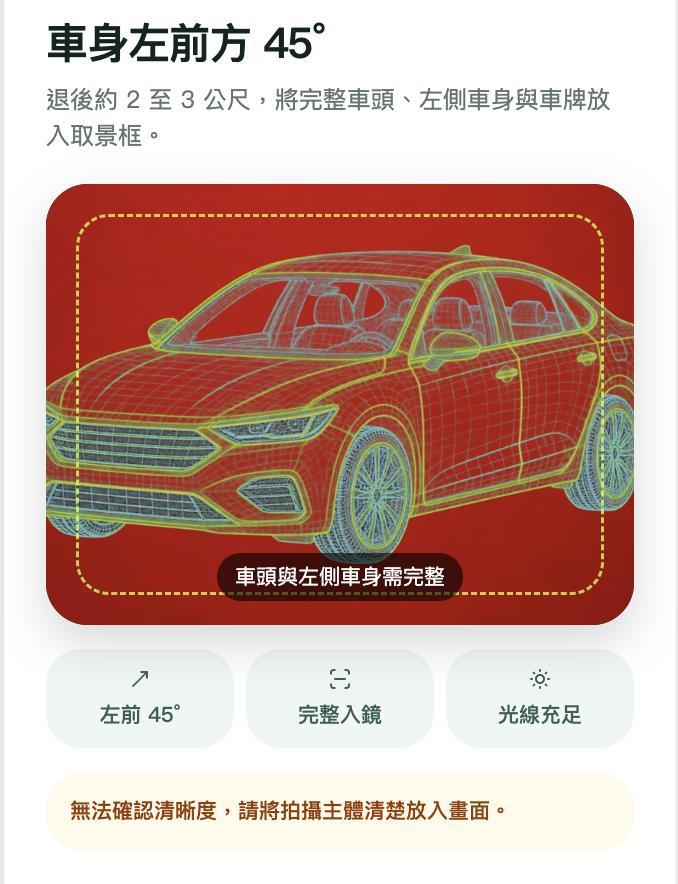
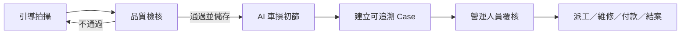
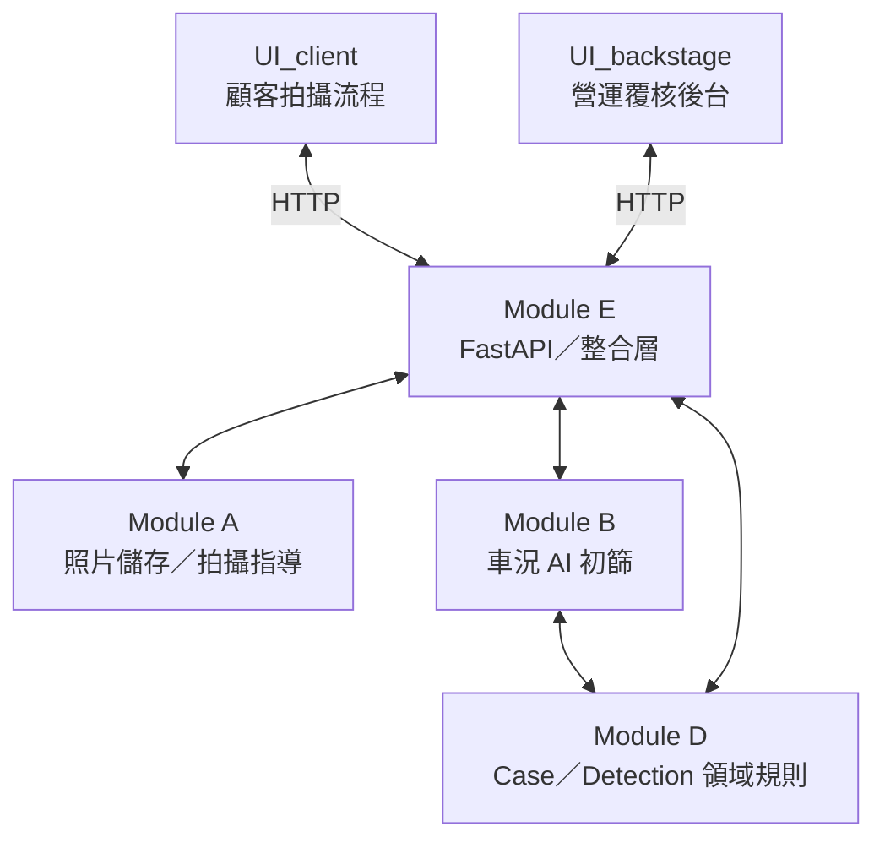

# iRent AI 車況智環

> 在使用者離開車輛前取得可用證據，讓 AI 協助篩出疑似異常，最終決策仍由營運人員完成。

**2026 和泰 AI 黑客松｜團隊：松鼠愛青椒**

iRent AI 車況智環把還車拍照、影像品質、AI 車損初篩、人工覆核與後續處置串成同一宗可追溯案件。它的重點不只是辨識刮痕，而是讓每張照片、每筆 AI 判讀與每次人工決策都有來源可查。

## 為什麼需要車況智環

自助還車常在使用者離開後才發現照片模糊、角度錯誤或車況有疑義。證據不足時，客服與營運人員只能回頭比對大量照片，處理時間拉長，也更容易產生爭議。

車況智環將流程前移：拍攝當下就提示如何修正，合格照片才進入證據鏈；AI 只負責初篩疑似車損，營運人員保留確認、修正、派工、付款與結案權限。

## 核心體驗

### 1. 引導拍攝與品質檢核

畫面依正在拍攝的項目提供取景框，供使用者作為參考對其標準。
同時，橘色方框內會顯示目前畫面的拍攝建議。及時指導



### 2. AI 車損初篩

現行模型針對單張還車照片辨識可見的 `scratch` 與 `collision_damage`，並保留判讀之信心分數、偵測編號與來源照片。


### 3. 營運人員覆核與處置

後台以案件佇列呈現待覆核項目。營運人員可查看證據、確認或修正 AI 標記，再依案件狀態派工、處理、設定付款或結案。信心分數在中等區間的，會要求人工審核(目前是xx%~xx%)


> 圖片擷取自團隊最終簡報中的實機 Demo；可辨識車牌已去識別化。

## 端到端流程



目前顧客端為 **RETURN-only** 流程，共拍攝油卡、前座、後座與四個車外角度。油卡與車內照會保存，但不送入現行車外損傷模型；四張車外照與選填的其他損傷照才會成為 Case evidence。

每筆 AI finding 都帶有 `source_photo_id`，Module B 轉為 Module D 的 `DetectionInput` 後，由 Module E 建立並保存 Case。系統不以陣列順序猜測照片來源，也不建立假的租前照片。

## 系統架構



| 模組 | 已實作責任 |
|---|---|
| Module A | 照片儲存、拍攝欄位與品質／構圖指導 |
| Module B | 可見車損 AI、`AIFinding`、來源照片追溯與 Case 建立協調 |
| Module D | Case、Detection、人工覆核、優先度、流程與付款規則 |
| Module E | FastAPI、HTTP schema／route、模組轉接與 in-memory Case 狀態 |
| UI_client | 顧客還車拍攝、上傳與 Case 結果畫面 |
| UI_backstage | 案件佇列、人工覆核與營運處置 |

## AI 與技術棧

- 拍攝指導：YOLOv8 Nano、OpenCV／幾何規則、六層級品質提示。
- 車外損傷：LR-ASPP + MobileNetV3-Large，共享 backbone 的 visible-damage gate 與像素分割 head。
- 後端：Python 3.10+、FastAPI、Pydantic；MVP 使用記憶體內 Case 儲存。
- 前端：React、TypeScript／JavaScript、Vinext／Vite。
- 測試：pytest、Vitest、Playwright。

## 驗證結果摘要

| 項目 | 資料與結果 | 正確解讀 |
|---|---|---|
| 拍攝指導 | 366 張既有驗證影像、1,461 個物件標註；物件偵測 recall 99.7%、precision 98.8%；7 張 Demo 判定一致 7/7 | 是物件偵測與小型 Demo 一致性，不是完整拍攝合規率；目前模板已啟用，仍需擴大場域驗證 |
| 和泰車損 locked test | 21 張：5/5 損傷照找出、正常照 11/16 判對；precision 50.0%、specificity 68.8%、balanced accuracy 84.4% | 5/5 不代表一般化的 100% 準確率；16 張正常照有 5 張誤報，因此必須人工覆核 |
| 外部車損分割 locked test | 163 張；scratch recall 100%、precision 63.8%；collision recall 100%、precision 96.9% | 外部資料只驗證損傷特徵保留，不等同和泰場域的類別正確率 |
| 車內清潔實驗 | 729 組 final test；污漬找出 88.5%、髒污找出 91.5% | 未部署，且提示真正命中的比例偏低，只能作人工覆核提示 |

完整資料切分、指標定義與限制見 [驗證與模型限制](docs/EVALUATION.md)。車損模型細節見 [Module B 架構與 fine-tuning 紀錄](module_b/ARCHITECTURE.md)。

## Quick Start

### 環境需求

- Python 3.10+
- Node.js 22.13+
- 已納入版本控制的 Module A／B checkpoint

### 1. 啟動後端

```powershell
python -m venv .venv
.\.venv\Scripts\Activate.ps1
python -m pip install -e ".[coach,ml,test]"
python -m uvicorn backend.main:app --reload
```

後端預設位於 `http://127.0.0.1:8000`。首次使用模型時會載入 checkpoint，CPU 環境可能需要較長時間。

### 2. 啟動顧客端

另開終端機：

```powershell
cd UI_client
npm install
$env:NEXT_PUBLIC_MODULE_E_BASE_URL = "http://127.0.0.1:8000"
npm run dev
```

依終端機顯示的網址開啟 `/capture`。

### 3. 啟動營運後台

另開終端機：

```powershell
cd UI_backstage
npm install
npm run dev
```

後台目前固定連線到 `http://127.0.0.1:8000`。

### 驗證指令

```powershell
python -m pytest -q
cd UI_client; npm test; npm run build
cd ..\UI_backstage; npm test; npm run build
```

## 倉庫結構

```text
backend/          Module E：FastAPI 與跨模組整合
module_a/         照片儲存與拍攝指導
module_b/         車外損傷 AI 與模型評估
module_d/         Case／Detection 領域規則
UI_client/        顧客端拍攝流程
UI_backstage/     營運覆核後台
artifacts/        已審核的模型 checkpoint 與指標
docs/             狀態、驗證、交接與 README 圖片
legacy/           第一版拍攝教練參考實作
tests/            Python 測試
```

文件入口與保留理由見 [文件索引](docs/README.md)。

## 目前限制

- 目前設定含 10 組已啟用模板（8 組車外、2 組駕駛側車內）；但仍不可把規則通過宣稱為精確 45 度、相機高度或完整場域準確率。
- 單張影像分數是模型輸出，不是校準後機率；AI 不判斷損傷新舊、肇責、理賠或維修金額。
- 和泰 locked test 只有 21 張，且損傷正例只有 5 張，仍需更大規模場域驗證。
- Case 使用 in-memory 儲存，重啟後端會清空；MVP 尚未加入資料庫。
- API 尚未提供完整租借人、車籍與照片 gallery contract，後台部分欄位仍以缺值呈現。
- `POST /dev/photos/force-save` 僅供本機 Demo，預設關閉，不能視為正常顧客功能。

## 團隊與致謝

- 團隊：**松鼠愛青椒**
- 專案：**2026 和泰 AI 黑客松｜iRent AI 車況智環**
- 車損特徵資料：Humans in the Loop Car Parts and Car Damages Dataset v2（CC0 1.0）
- 車內清潔實驗資料：MoLa-VI（CC BY 4.0；僅實驗，未部署）

---

本專案是黑客松原型。任何正式上線、理賠或責任判定都需要額外的資安、隱私、法遵、模型校正與場域驗證。
