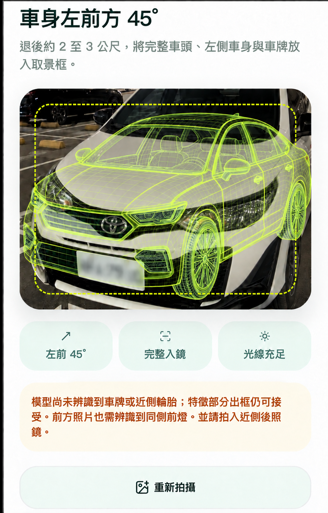
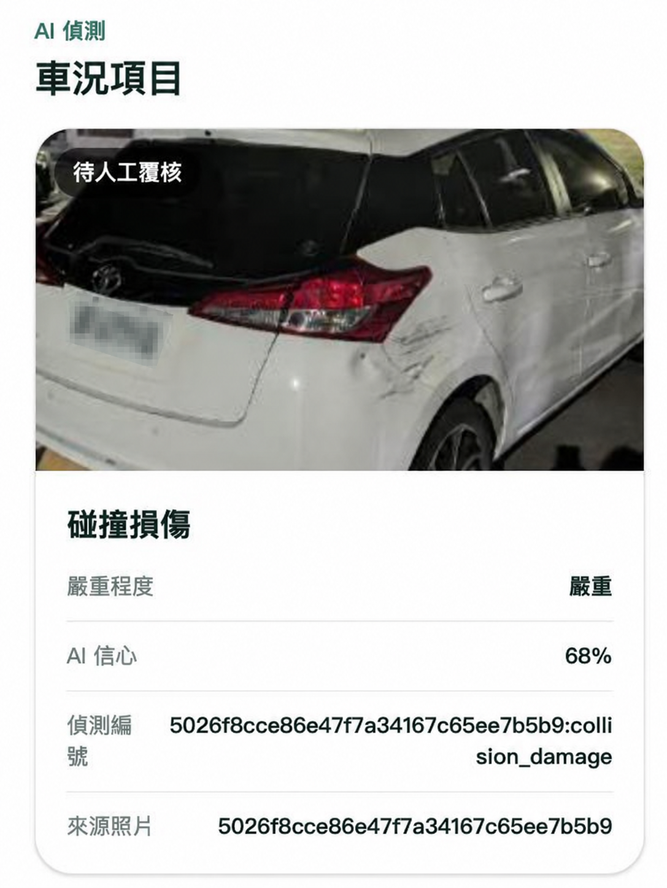
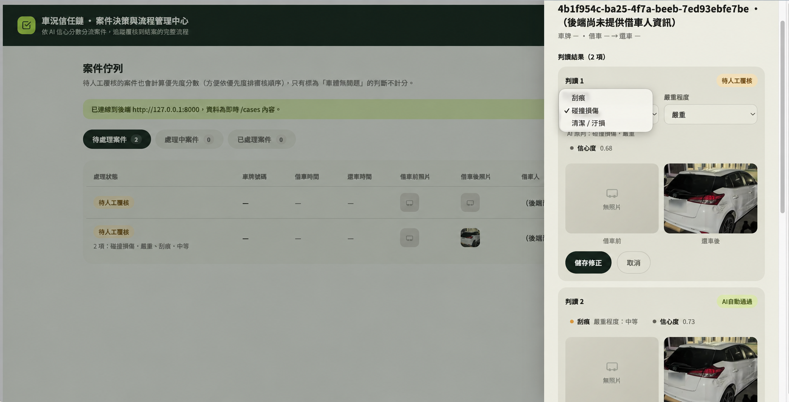
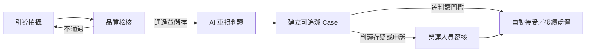

# iRent AI 車況智環

> 在使用者離開車輛前取得可用證據，由 AI 完成常規車況判讀；並在判讀存疑或使用者申訴時，轉交營運人員覆核。

**2026 和泰 AI 黑客松｜團隊：松鼠愛青椒**

[觀看專案影片介紹](https://youtu.be/QBDsVe79QPU)

iRent AI 車況智環以拍攝指導先提升還車照片的可用性，再由 AI 接手例行照片審核；當信心分數不足或使用者提出申訴時，案件才轉交營運人員覆核，兼顧自動化效率與誤判修正機制。

## 為什麼需要車況智環

自助還車常在使用者離開後才發現照片模糊、角度錯誤或車況有疑義。證據不足時，客服與營運人員只能回頭比對大量照片，處理時間拉長，也更容易產生爭議。

車況智環將流程前移：拍攝當下就提示如何修正，合格照片才進入證據鏈；AI 完成常規車損判讀，取代逐案人工檢查，只有低信心、判讀存疑或使用者申訴的案件才轉交人工覆核。

## 核心體驗

### 1. 引導拍攝與品質檢核

拍攝畫面會依指定角度顯示取景框，協助使用者對齊車身、確認完整入鏡與光線狀況。若照片尚未符合要求，畫面下方會立即說明原因並提示如何重拍。



### 2. AI 車損判讀

現行模型針對單張還車照片辨識可見的 `scratch` 與 `collision damage`，並保留判讀之信心分數、偵測編號與來源照片。



### 3. 例外覆核與營運處置

後台提供案件佇列，讓營運人員處理 AI 存疑或使用者申訴的例外案件，查看照片與 AI 判讀後，確認或修正損傷類別與嚴重程度，再依案件狀態執行後續處置。原型目前以 0.70 為門檻：低於 0.70 的判讀會進入人工覆核；達到或高於 0.70 時先標記為自動接受。此門檻可調整，尚不是正式營運規則。



> 圖片擷取自團隊最終簡報中的實機 Demo；車輛影像來自 iRent 提供的訓練資料，README 所示畫面已將可辨識車牌模糊處理。

## 端到端流程



目前顧客端為 **RETURN-only** 流程，共拍攝油卡、前座、後座與四個車外角度。油卡與車內照會保存，但不送入現行車外損傷模型；四張車外照與選填的其他損傷照才會成為 Case evidence。

每筆 AI finding 都帶有 `source_photo_id`，Module B 轉為 Module D 的 `DetectionInput` 後，由 Module E 建立並保存 Case。系統不以陣列順序猜測照片來源，也不建立假的租前照片。

## 系統架構


| 模組 | 已實作責任 |
|---|---|
| Module A | 照片儲存、拍攝欄位與品質／構圖指導，以及離線借還影像比較原型 |
| Module B | 可見車損 AI、`AIFinding`、來源照片追溯與 Case 建立協調 |
| Module D | Case、Detection、人工覆核、優先度、流程與付款規則 |
| Module E | FastAPI、HTTP schema／route、模組轉接與 in-memory Case 狀態 |
| UI_client | 顧客還車拍攝、上傳與 Case 結果畫面 |
| UI_backstage | 案件佇列、人工覆核與營運處置 |

## AI 與技術棧

- 拍攝指導：YOLOv8 Nano、OpenCV／幾何規則、六層級品質提示。
- 借還影像比較原型：以車輛偵測、特徵對位、比較區遮罩與候選熱圖協助離線檢查；尚未接入正式還車流程。
- 車外損傷：LR-ASPP + MobileNetV3-Large，共享 backbone 的 visible-damage gate 與像素分割 head。
- 後端：Python 3.10+、FastAPI、Pydantic；MVP 使用記憶體內 Case 儲存。
- 前端：React、TypeScript／JavaScript、Vinext／Vite。
- 測試：pytest、Vitest、Playwright。

## 驗證結果摘要

| 項目 | 與原型的關係 | 資料與結果 | 解讀 |
|---|---|---|---|
| 拍攝指導 | 已整合原型主流程 | 366 張既有驗證影像、1,461 個物件標註；物件偵測 recall 99.7%、precision 98.8%；7 張 Demo 判定一致 7/7 | 模型能穩定找出拍攝指導所需的車輛零件，7 張 Demo 的結果也一致；完整還車流程仍需更多現場照片驗證 |
| 和泰車損 locked test | 已整合原型主流程 | 21 張：5/5 損傷照找出、正常照 11/16 判對；precision 50.0%、specificity 68.8%、balanced accuracy 84.4% | 5 張損傷照皆成功辨識，但 16 張正常照中仍有 5 張遭誤判；原型以 AI 作為主要判讀者，低信心或申訴案件轉交人工，目前仍須擴大場域驗證 |
| 外部車損分割 locked test | 整合車損模型的外部資料評估 | 163 張；scratch recall 100%、precision 63.8%；collision recall 100%、precision 96.9% | 外部資料顯示模型可保留損傷特徵，但資料分布不同，不能直接視為 iRent 場域表現 |
| 車內清潔實驗 | 獨立實驗，未整合 | 729 組 final test；污漬找出 88.5%、髒污找出 91.5% | 僅為獨立實驗結果，尚未接入目前的拍攝、Case 或後台流程 |

完整資料切分、指標定義與限制見 [驗證與模型限制](docs/EVALUATION.md)。車損模型細節見 [Module B 架構與 fine-tuning 紀錄](module_b/ARCHITECTURE.md)。

## 借還影像比較原型

Module A 提供離線借還影像比較原型，可針對同一車外視角的已儲存照片產生可比較性診斷、比較區遮罩與候選變化熱圖。使用前仍須由可信租借資料確認照片屬於同一車輛與租次；這項功能尚未接入目前的 UI、Module E API 或 Module B 車損流程，候選熱區也不是車損判定。技術契約與限制見 [Module A 說明](module_a/README.md#借還影像比較原型)。

## Quick Start

### 環境需求

- Python 3.10+
- Node.js 22.13+

### 1. 啟動後端

```powershell
python -m venv .venv
.\.venv\Scripts\Activate.ps1
python -m pip install -e ".[coach,ml,test]"
python -m uvicorn backend.main:app --reload
```

後端預設位於 `http://127.0.0.1:8000`。首次使用模型時會載入 checkpoint，CPU 環境可能需要較長時間。

### 2. 啟動顧客端

另開終端機：

```powershell
cd UI_client
npm install
$env:NEXT_PUBLIC_MODULE_E_BASE_URL = "http://127.0.0.1:8000"
npm run dev
```

依終端機顯示的網址開啟 `/capture`。

### 3. 啟動營運後台

另開終端機：

```powershell
cd UI_backstage
npm install
npm run dev
```

後台目前固定連線到 `http://127.0.0.1:8000`。

### 驗證指令

```powershell
python -m pytest -q
cd UI_client; npm test; npm run build
cd ..\UI_backstage; npm test; npm run build
```

## Demo 操作流程

1. 依 Quick Start 啟動後端、顧客端與營運後台；這三個程序都必須保持執行。
2. 在顧客端開啟 `/capture`，依畫面完成 RETURN-only 拍攝。每張照片會先取得拍攝指導，再上傳至後端；通過後由後端回傳 `photo_id`。
3. 完成必要照片後，顧客端會以已接受的車外照片建立 Case，並顯示後端回傳的案件結果。
4. 開啟營運後台，在案件佇列找到新案件，查看 AI 車損判讀與來源照片。
5. 示範例外流程：由營運人員覆核 AI 存疑或使用者申訴的案件，視需要修正損傷類別與嚴重程度，再執行後續處置。

若 Demo 照片無法通過正式拍攝指導，可在啟動後端前設定 `$env:HOTAI_ENABLE_DEV_FORCE_SAVE = "1"`，使用上傳失敗後出現的測試用強制接受功能。這是預設關閉的本機開發輔助，不屬於正式顧客流程，也不會改變 `POST /photos` 的正常判定。

## 倉庫結構

```text
backend/          Module E：FastAPI 與跨模組整合
module_a/         照片儲存與拍攝指導
module_b/         車外損傷 AI 與模型評估
module_d/         Case／Detection 領域規則
UI_client/        顧客端拍攝流程
UI_backstage/     營運覆核後台
artifacts/        已審核的模型 checkpoint 與指標
docs/             狀態、驗證、交接與 README 圖片
legacy/           第一版拍攝教練參考實作
tests/            Python 測試
```

文件入口與保留理由見 [文件索引](docs/README.md)。

## 目前限制

- 目前已提供 8 組車外與 2 組車內拍攝指引。系統可檢查車輛是否大致符合取景要求，但還不能精準判斷拍攝角度是否為 45 度或相機高度是否正確，且仍需透過更多車款與實際場景驗證。
- 八類拍攝模型已支援近側後照鏡；轎車四個外觀角度曾以 Demo 照片校正並通過，但休旅車與獨立實拍驗證仍未完成。
- 單張影像分數是模型輸出，不是校準後機率；AI 不判斷損傷新舊、肇責、理賠或維修金額。
- 目前locked test 只有 21 張，且損傷正例只有 5 張，仍需更大規模場域驗證。
- Case 使用 in-memory 儲存，重啟後端會清空；MVP 尚未加入資料庫。
- API 尚未提供完整租借人、車籍與照片 gallery contract，後台部分欄位仍以缺值呈現。
- `POST /dev/photos/force-save` 僅供本機 Demo，預設關閉，不能視為正常顧客功能。
- 借還影像比較只提供候選變化與可比較性診斷，尚未驗證為車損判定，也未接入正式 API 或 UI。

## 團隊與致謝

- 團隊：**松鼠愛青椒**
- 專案：**2026 和泰 AI 黑客松｜iRent AI 車況智環**
- 車損特徵資料：Humans in the Loop Car Parts and Car Damages Dataset v2（CC0 1.0）
- 車內清潔實驗資料：MoLa-VI（CC BY 4.0；僅實驗，未部署）

---

本專案是黑客松原型。任何正式上線、理賠或責任判定都需要額外的資安、隱私、法遵、模型校正與場域驗證。
