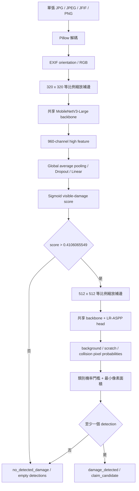

# Module B 架構與 Fine-tuning 技術紀錄

## 1. 模組責任與目前版本

Module B 接收一張 JPG、JPEG、JFIF 或 PNG 車輛照片，輸出圖片層級的可見損傷
評估。現行 checkpoint 是：

```text
artifacts/module_b/damage_multitask.pth
model_version = lraspp-mobilenetv3-large-hotai-multitask-v1
status = experimental_review_only
```

輸出狀態只有：

- `damage_detected`：visible-damage gate 通過，且至少一個損傷類別通過分割 gate。
- `no_detected_damage`：沒有任何損傷 detection。

目前可輸出的損傷類別為 `scratch` 與 `collision_damage`。`no_detected_damage`
是衍生狀態，不是第三種損傷類別，也沒有 severity。Module B 不判斷損傷是否為
本次租車造成、索賠責任、維修金額或保險條款，因此 `claim_candidate` 只是可見損傷
候選，不是正式的 claim 決策。所有 detection 均輸出 `needs_review`。

## 2. 推論資料流



推論時 gate 和 segmentation 依序執行；gate 沒通過就不執行分割。通過時模型會
再次以 512×512 輸入執行 segmentation。兩個任務使用同一組已 fine-tune 的
MobileNetV3-Large backbone 參數。

## 3. 使用的模型

### 3.1 Backbone

- TorchVision `MobileNetV3-Large`。
- 初始 backbone 使用 ImageNet 預訓練權重。
- 選擇原因是模型相對輕量，能在 CPU fallback，也能使用 CUDA/AMP 訓練與推論。

### 3.2 損傷分割 head

- TorchVision `LR-ASPP MobileNetV3-Large`。
- 輸出三個 pixel logits：`background`、`scratch`、`collision_damage`。
- LR-ASPP 同時使用 MobileNetV3 的 low-level 與 high-level feature，保留局部邊界與
  高階語意。
- pixel logits 經 softmax 轉為每類像素分數。

### 3.3 Visible-damage gate

共享 backbone 的 `high` feature map 有 960 channels，gate 依序套用：

```text
960-channel high feature
→ AdaptiveAvgPool2d(1)
→ Flatten
→ Dropout(p=0.2)
→ Linear(960, 1)
→ sigmoid
```

這個 head 判斷單張照片是否有「可見損傷」，不直接分類 scratch/collision，也不使用
原始 claim folder 當單張照片真值。

## 4. 訓練資料

### 4.1 HITL 車損 polygon 資料

來源是 Humans in the Loop 的 Car Parts and Car Damages Dataset v2，授權為 CC0 1.0。
原始壓縮檔有 1,812 組圖片與 Supervisely JSON annotation；匯入時：

1. 以 annotation 的 `classTitle` 判定 collection，避免依賴名稱顛倒的資料夾。
2. 排除只標註零件、沒有車損標註的 collection；「沒有標損傷」不能假設為負例。
3. 以 perceptual hash 去重，避免同圖或複本跨 train/validation/test。
4. 產生 814 張唯一的 damage-annotated 圖片。

類別映射如下：

| HITL polygon | Module B pixel class |
|---|---|
| `Scratch` | `scratch`（pixel id 1） |
| `Dent` | `collision_damage`（pixel id 2） |
| `Cracked` | `collision_damage`（pixel id 2） |
| `Broken part` | `collision_damage`（pixel id 2） |
| `Missing part` | `collision_damage`（pixel id 2） |
| 其他或未標註像素 | `background`（pixel id 0） |

814 張的圖片層級組成：

| 標籤組合 | 張數 |
|---|---:|
| 兩個目標類別皆無 | 3 |
| 只有 `collision_damage` | 294 |
| 只有 `scratch` | 12 |
| 兩者都有 | 505 |

因此 HITL 有 517 個 scratch 正例與 297 個 scratch 負例，但 collision 只有 15 個
負例、799 個正例。這是目前 collision false-positive 風險的重要來源，不能把 HITL
測試結果解讀成和泰場域的正式分類正確率。

HITL 以 perceptual-hash group 做 60%/20%/20% 隔離，固定 seed `20260914`：

| Split | 張數 |
|---|---:|
| Train | 488 |
| Validation | 163 |
| Locked test | 163 |

### 4.2 和泰人工單張標註

從原始和泰照片建立固定 100 張標註 queue，以車牌群組輪流取樣，避免少數車輛
佔滿 queue。人工標註的是單張照片的：

- `visible_damage = yes / no / uncertain`
- 若為 yes，可附 `scratch`、`collision_damage`、兩者或 `uncertain_category`

其中 99 張可轉為 binary label：23 張有可見損傷、76 張無可見損傷；1 張
`uncertain` 排除。binary gate 只使用 visible-damage yes/no；category 附註只作
診斷，不拿來取代 HITL polygon segmentation。

切分時以車牌為 group，同一台車不得跨集合。固定 split 為：

| Split | 張數 |
|---|---:|
| Train | 61 |
| Validation | 17（4 positive / 13 negative） |
| Locked test | 21（5 positive / 16 negative） |

原始「進行索賠／沒有進行索賠」資料夾不作單張 supervised label，因為索賠案件內
不是每一張照片都會拍到損傷。未進入 100 張 queue 的和泰圖片也沒有被 pseudo-label。

### 4.3 沒有使用的資料

- SOCAR：未取得可用資料與充分授權，因此未使用。
- 來源不明的網路圖片與 Roboflow re-upload：未使用。
- HITL part-only polygon：不能視為無損傷負例，因此未使用。
- cleanliness：沒有建立這個類別，也沒有拿「非 scratch/collision」冒充 cleanliness。

## 5. HITL polygon 如何轉成模型特徵

HITL 提供的是 Supervisely polygon，而不是可以直接送入 loss 的像素矩陣。資料載入
流程如下：

1. Pillow 載入原圖，套用 EXIF orientation 並轉 RGB。
2. 讀取 annotation 中的原圖 width/height，先驗證與圖片尺寸一致。
3. 每個支援的 polygon exterior 被畫入 binary mask；interior polygon 重新清為 0，
   因此洞不會被誤標為損傷。
4. 同類 polygon 以 union 合併。
5. 先把 scratch 貼成 pixel id 1，再把 collision 貼成 pixel id 2；重疊處由 collision
   覆蓋，避免一個像素同時有兩個 mutually-exclusive target。
6. 圖片與 mask 使用完全相同的 letterbox 幾何轉為 512×512。圖片用 bilinear
   interpolation；mask 必須用 nearest-neighbor，避免產生不存在的小數類別。
7. 圖片轉 tensor 並套用 ImageNet normalization；mask 轉成 int64 class index。

分割模型從圖片抽出 low/high feature map，LR-ASPP head 將 feature 轉成三類 pixel
logits。訓練使用 pixel-level cross entropy；推論時 softmax 後統計超過類別門檻的
像素數。只有像素數同時超過最小面積 gate，該類別才成為 image-level detection。

現行 base gates 為：

| Category | Pixel probability threshold | Minimum area |
|---|---:|---:|
| `scratch` | 0.25 | 16 pixels |
| `collision_damage` | 0.45 | 16 pixels |

輸出的 category confidence 是通過 threshold 像素分數的第 95 百分位，不是校準後的
損害機率、索賠機率或嚴重程度。

## 6. 圖片前處理與 augmentation

### 6.1 共通處理

- Pillow 解碼，不依賴 `ImageFolder` 的副檔名過濾。
- 支援 JPG、JPEG、JFIF、PNG。
- EXIF orientation 後轉 RGB，不改寫原始圖片。
- 使用 ImageNet normalization：
  - mean = `(0.485, 0.456, 0.406)`
  - std = `(0.229, 0.224, 0.225)`

### 6.2 HITL segmentation

- 尺寸：512×512 letterbox。
- 圖片與 mask 同步水平翻轉，機率 0.5。
- 不使用會破壞 polygon 對齊的獨立 image-only augmentation。

### 6.3 和泰 binary gate

- 尺寸：320×320 letterbox。
- 訓練時使用：
  - Random horizontal flip，`p=0.5`
  - Random affine：rotation ±5°、translate 2%、scale 0.95–1.05
  - Color jitter：brightness 0.15、contrast 0.15、saturation 0.1
- Validation、locked test 與正式推論不使用隨機 augmentation。

## 7. 正反例與像素類別平衡

### 7.1 HITL pixel imbalance

背景像素遠多於小面積損傷像素。分割訓練先統計 train split 每個 pixel class 的
數量，令頻率為 `frequency_c`，class weight 為：

```text
raw_weight_c = 1 / sqrt(frequency_c)
weight_c = normalize_to_mean_1(raw_weight_c)
weight_c = min(weight_c, 20)
```

再將 weights 傳給 `CrossEntropyLoss`。平方根反比比完整反比溫和，避免極少量像素
讓梯度完全支配訓練；最大 20 倍則限制極端權重。

### 7.2 和泰 image-level imbalance

和泰可用資料為 23 positive、76 negative。只用原始分布訓練時，模型容易偏向多數
類別；早期 claim 模型反過來使用高 `pos_weight` 又導致幾乎所有照片都判成正例。
現行 multi-task 版本改用 `WeightedRandomSampler`：

```text
sample_weight_i = 1 / count(label_i)
num_samples_per_epoch = 2 × max(positive_count, negative_count)
replacement = True
```

因此少數 positive 在每個 epoch 會被較常抽到，期望抽樣比例接近 1:1，但不複製
實體圖片檔案。因為 sampler 已平衡類別，binary loss 使用一般
`BCEWithLogitsLoss()`，`pos_weight = 1`，不再重複補償正類。Validation 和 locked
test 完全不做 balanced sampling，保留實際比例以量測誤報。

## 8. Fine-tuning 階段

### 8.1 Base HITL segmentation 預訓練

先用 ImageNet backbone 建立三類 LR-ASPP segmenter：

1. Head stage：凍結整個 backbone，只訓練 LR-ASPP classifier。
   - AdamW
   - head LR `1e-3`
   - 最多 10 epochs
2. Fine-tune stage：解凍 backbone 最後三個 blocks。
   - backbone LR `1e-5`
   - segmentation head LR `1e-4`
   - 最多 30 epochs
3. Weight decay `1e-4`、batch size 4、AMP、patience 7。
4. Validation threshold 搜尋 `0.10` 到 `0.90` 共 17 個候選，最小面積搜尋
   `16/64/256`，依序最大化 F2、recall、precision；locked test 不參與 gate 選擇。

完成後得到 base checkpoint `damage_segmenter.pth`，再作為 multi-task 初始化，而不是
每次從 ImageNet 重新開始。

### 8.2 Multi-task head stage

載入 base segmenter 後新增 visible-damage gate：

- 凍結 segmentation backbone 與 LR-ASPP classifier。
- 只訓練 gate head。
- Gate batch size 8。
- AdamW，LR `1e-3`，weight decay `1e-4`。
- 最多 12 epochs、early-stopping patience 6。
- 本次選到第 2 epoch 的 head state。

此階段讓新 head 先學會使用 HITL 已抽出的 damage feature，避免一開始就用 99 張小
資料大幅改壞 backbone。

### 8.3 Joint fine-tuning

Joint stage 解凍：

- MobileNetV3 backbone 最後三個 blocks。
- LR-ASPP segmentation head。
- Visible-damage gate head。

每個 optimizer step 先取一個 balanced Hotai batch，再取一個 HITL segmentation
batch。兩個 loss 累積梯度後只執行一次 optimizer step：

```text
L_total = BCEWithLogitsLoss(hotai_gate)
        + 0.5 × WeightedCrossEntropyLoss(hitl_pixel_mask)
```

HITL loss 的目的不是把 HITL 圖片當 claim 標籤，而是限制 shared backbone 在適應
和泰時不要忘記 scratch/collision 的局部特徵。各參數群組：

| Parameter group | Learning rate |
|---|---:|
| Last 3 backbone blocks | `1e-5` |
| Visible-damage gate | `1e-4` |
| LR-ASPP segmentation head | `1e-4` |

其他設定：

- Hotai batch size 8。
- HITL segmentation batch size 2。
- Segmentation loss weight 0.5。
- Weight decay `1e-4`。
- 最多 24 epochs、patience 6。
- CUDA 時使用 automatic mixed precision；沒有 CUDA 時可退回 CPU。
- frozen weights 不更新；joint stage 的 BatchNorm running statistics 仍會接觸交替的
  HITL/Hotai batches，用來適應兩個 domain。
- 本次選到第 9 joint epoch。

## 9. Model selection、門檻與品質閘門

每個 epoch 都在 Hotai validation set 計算 sigmoid score。候選 threshold 只來自
validation scores，先要求 validation recall 至少 0.75；符合者選 specificity 最高，
再依 precision、false-positive count 與 threshold 打破平手。不同 epoch 再依序比較：

1. balanced accuracy
2. specificity
3. recall

Locked test 從不參與 epoch 或 threshold 選擇。本次選出的 threshold 是：

```text
visible_damage_threshold = 0.4106065548800782
```

checkpoint 發布前還必須在 locked test 同時滿足：

- visible-damage recall ≥ 0.80
- no-visible-damage specificity ≥ 0.50

任何一項失敗都只寫 diagnostic metrics，不能產生可交付 checkpoint。這個 fail-closed
設計避免把全判 positive、看似零漏判的模型冒充成成功版本。

## 10. 實際驗證結果

### 10.1 Hotai validation

| 指標 | 結果 |
|---|---:|
| Confusion matrix | `[[10, 3], [1, 3]]` |
| Recall | 75.0% |
| Specificity | 76.9% |
| Precision | 50.0% |
| Accuracy | 76.5% |
| Balanced accuracy | 76.0% |

### 10.2 Hotai locked test

| 指標 | 結果 |
|---|---:|
| Confusion matrix | `[[11, 5], [0, 5]]` |
| 損傷 recall | 100%（5/5） |
| 無損傷 specificity | 68.8%（11/16） |
| Claim-candidate precision | 50.0%（5/10） |
| No-damage NPV | 100%（11/11） |
| False-positive rate | 31.2%（5/16） |
| Accuracy | 76.2%（16/21） |
| Balanced accuracy | 84.4% |

這個結果通過實驗門檻，但 locked test 只有 5 張 positive。5/5 沒有漏判不代表真實
場域 recall 已穩定為 100%；模型仍維持 `experimental_review_only`。

### 10.3 HITL segmentation locked test

| Category | Recall | Precision | F2 | Pixel IoU |
|---|---:|---:|---:|---:|
| `scratch` | 100% | 63.8% | 89.8% | 8.84% |
| `collision_damage` | 100% | 96.9% | 99.4% | 30.09% |

HITL image-level recall 很高，但 scratch pixel IoU 低，而且 HITL collision negatives
極少。這些數字只能說明外部資料上的 feature 保留情況，不能等同 Hotai category
準確率。

## 11. 失敗實驗與調整理由

### 11.1 舊 claim/no-claim classifier

原始 MobileNetV3-Large claim v1 使用案件資料夾標籤、`pos_weight` 與零 false-negative
門檻。Locked test 雖然 claim recall 100%，但 48 張 no-claim 只有 2 張判對，
specificity 約 4.2%。原因是案件標籤不等於每張照片的可見損傷真值，加上正類加權與
極低 threshold 把模型推向幾乎全 positive。

### 11.2 獨立 visible-damage classifier

使用 99 張人工標註、ImageNet MobileNetV3-Large 獨立 fine-tune 時，90% OOF recall
約束得到 OOF specificity 21.7%，locked specificity 0%。它沒有利用 HITL polygon
學到的局部損傷 feature，因此採 fail-closed，沒有發布 `damage_with_gate.pth`。

### 11.3 現行修正

現行版本的關鍵變更是：

- 外部 HITL 只提供「損傷長什麼樣、位於哪裡」的 supervision。
- Hotai 人工標註只提供「這張照片有沒有可見損傷」的 domain-specific supervision。
- 共享 backbone，但保留兩個 head 與兩種 loss，不混淆 label semantics。
- 以 balanced sampler 取代 sampler 加高 `pos_weight` 的雙重補償。
- validation threshold 允許少量漏判以換取可用 specificity，再由未參與調參的 locked
  test 驗收 recall 和 specificity。

## 12. 公開 API

```python
from module_b import load_damage_segmentation_model, predict_damage_assessment

bundle = load_damage_segmentation_model(
    "artifacts/module_b/damage_multitask.pth",
    device="auto",
)

assessment = predict_damage_assessment(
    bundle,
    "example.jfif",
    photo_id="photo-001",
)

payload = assessment.to_dict()
```

有 detection 時的輸出範例：

```json
{
  "photo_id": "photo-001",
  "damage_state": "damage_detected",
  "claim_candidate": "claim_candidate",
  "detections": [
    {
      "photo_id": "photo-001",
      "category": "scratch",
      "severity": "moderate",
      "confidence": 0.81,
      "review_state": "needs_review",
      "model_version": "lraspp-mobilenetv3-large-hotai-multitask-v1"
    }
  ],
  "review_state": "needs_review",
  "model_version": "lraspp-mobilenetv3-large-hotai-multitask-v1"
}
```

沒有 detection 時 `detections` 是空 list，`damage_state` 是
`no_detected_damage`，`claim_candidate` 是 `no_claim_candidate`。底層
`predict_damage_conditions()` 可直接取得零到兩筆 detection，輸出順序固定為
`collision_damage`、`scratch`。

固定業務映射：

| Category | Severity | Review state |
|---|---|---|
| `scratch` | `moderate` | `needs_review` |
| `collision_damage` | `severe` | `needs_review` |

## 13. 重現訓練

```powershell
.\.venv\Scripts\python.exe -m module_b.train_multitask_damage `
  --manifest data\condition_manifest.hitl-only.json `
  --queue data\hotai_annotation_queue.json `
  --annotations data\hotai_annotations.json `
  --base-checkpoint artifacts\module_b\damage_segmenter.pth `
  --output-dir artifacts\module_b `
  --device auto `
  --gate-batch-size 8 `
  --segmentation-batch-size 2 `
  --minimum-validation-recall 0.75 `
  --minimum-locked-recall 0.80 `
  --minimum-locked-specificity 0.50
```

固定 seed 是 `20260914`，資料群組會先排序再分割，降低跨程序 set iteration 順序
造成的不穩定。Python dependencies 定義在 `pyproject.toml` 的 `ml` extra。

Git repository 已包含程式碼與最終 checkpoint，因此其他成員可以重現推論；原始
HITL、Hotai 圖片、annotation queue 與人工標註依資料治理規則不進 Git，所以沒有
私有資料的人不能只靠 repository 從零重訓完全相同模型。

## 14. Checkpoint 內容與限制

`damage_multitask.pth` 包含：

- shared MobileNetV3-Large backbone state dict
- LR-ASPP segmentation head state dict
- visible-damage gate head state dict
- 320/512 preprocessing metadata
- pixel classes、category thresholds 與 minimum areas
- visible-damage threshold
- severity mapping、review state、model version
- HITL manifest SHA-256
- validation 與 locked-test 指標

目前限制：

- Hotai locked positive 只有 5 張，統計不穩定。
- 沒有獨立、充足的 Hotai scratch/collision polygon test set。
- HITL collision negatives 極少，category false positive 仍可能很高。
- confidence 是模型分數，不是實際理賠機率或損傷嚴重程度。
- 模型不比較借車前後照片，也不知道既有損傷。
- 模型不比較借車照與還車照；backend 目前將兩張照片分別執行單張推論。

## 15. Backend adapter 與 Module D 串接

`DamageModelAnalyzer` 保留既有單張模型 API，僅負責把 backend 提供的
`list[tuple[photo_id, bytes]]` 逐張轉交給 `predict_damage_conditions()`。每筆結果
會轉成 `AIFinding`，內容包含唯一 `detection_id`、`source_photo_id`、Module D enum
形式的 category/severity，以及原始 confidence。

`CaseBuildingModuleB` 使用 Module A 的 `PhotoType` 與 `CaptureSlot` metadata 驗證
multi-photo input。模型支援的固定車身 slot 可傳完整 borrow/return pair，也可只傳
return；borrow-only 仍會拒絕，同 slot 的重複 borrow 或 return 也會拒絕。return-only
finding 會轉成 `borrow_photo_id=None` 的 `DetectionInput`。完整 pair 的 finding 則依
必填的 `source_photo_id` 取得同 slot 的 borrow/return evidence pair。

`RETURN + OTHER_DAMAGE` 維持可出現多張、不要求 borrow counterpart 的規則，每張
照片都有獨立的 return-only evidence。`FUEL_PARKING_CARD`、`INTERIOR_FRONT` 與
`INTERIOR_REAR` 仍可存在於 Module A，但不屬於目前 damage model 的輸入 domain，
所以 orchestrator 會驗證 metadata 後將它們排除，不傳給 analyzer。

Module D 接著依 `DecisionPolicy.review_confidence_threshold` 決定 `needs_review` 或
`auto_accepted` 並計算 priority；因此 B 不重作 D 的 review 或 priority 規則。

CaptureSlot metadata 目前只用於 analyzer filtering、photo-set 結構驗證與 evidence ID
對應。`FRONT_LEFT`、`FRONT_RIGHT`、`REAR_LEFT`、`REAR_RIGHT`、`REAR` 與
`OTHER_DAMAGE` 會逐張送入現有單張 damage model。完整 pair 的兩張照片仍各自推論；
目前沒有真正的 borrow/return 視覺差異比較或責任判定。
