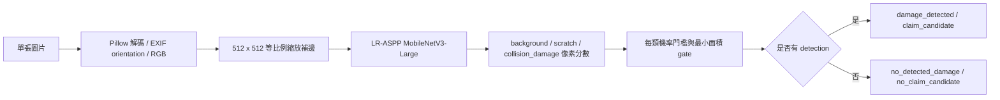

# Module B 架構

## 模組責任

Module B 接收一張 JPG、JPEG、JFIF 或 PNG 車輛照片，輸出圖片層級評估：

- `damage_detected`：至少一個 `scratch` 或 `collision_damage` 通過模型 gate。
- `no_detected_damage`：兩種損傷都沒有通過 gate。

`no_detected_damage` 是衍生狀態，不是第三種損傷，也沒有 severity。Module B
不判斷索賠責任、維修金額或實際損傷程度；所有輸出均為 `needs_review`。

## 資料流



模型使用 HITL polygon mask 訓練。HITL `Scratch` 映射到 `scratch`；`Dent`、
`Cracked`、`Broken part`、`Missing part` 映射到 `collision_damage`。兩者重疊時
collision 像素優先。

## 公開 API

```python
from module_b import load_damage_segmentation_model, predict_damage_assessment

bundle = load_damage_segmentation_model(
    "artifacts/module_b/damage_segmenter.pth",
    device="auto",
)
assessment = predict_damage_assessment(bundle, "example.jfif", "photo-001")
payload = assessment.to_dict()
```

有損傷時：

```json
{
  "photo_id": "photo-001",
  "damage_state": "damage_detected",
  "claim_candidate": "claim_candidate",
  "detections": [
    {
      "photo_id": "photo-001",
      "category": "scratch",
      "severity": "moderate",
      "confidence": 0.81,
      "review_state": "needs_review",
      "model_version": "lraspp-mobilenetv3-large-damage-v1"
    }
  ],
  "review_state": "needs_review",
  "model_version": "lraspp-mobilenetv3-large-damage-v1"
}
```

未偵測到損傷時，`detections` 是空 list，Module D 也應接收空 detections。
`claim_candidate` 只是第一版的候選規則：偵測到損傷就列為索賠候選；它不是正式
理賠結論。可見損傷可能是既有損傷，模型也可能因模糊、遮擋或 domain shift 漏判。

底層 `predict_damage_conditions()` 仍可直接取得零到兩筆 detection。輸出順序固定
為 `collision_damage`、`scratch`。confidence 是通過 gate 像素分數的第 95
百分位，不是校準後的損害或索賠機率。

## 固定業務映射

| Category | Severity | Review state |
|---|---|---|
| `scratch` | `moderate` | `needs_review` |
| `collision_damage` | `severe` | `needs_review` |

## 資料與限制

- HITL damage polygon 用於模型訓練。
- iRent claim/no-claim 標籤只用於外部 proxy 評估，不用於 category 訓練或調門檻。
- iRent 沒有 scratch/collision 標註，因此不能計算各 category 真實準確率。
- SOCAR、零件 polygon 與來源不明圖片不納入訓練。
- checkpoint 維持 `experimental_review_only`；取得獨立 iRent category 標註前，
  不得宣稱 production-ready 或自動判賠。

目前聚合器使用超過機率門檻的總像素面積，不是連通元件或 bounding box。若要向
人工呈現損傷位置，後續應增加 mask／bounding-box 輸出。

## iRent 可見損傷 gate 實驗現況

人工標註的 100 張照片中有 99 張可用（23 張可見損傷、76 張無可見損傷），另有
1 張 `uncertain` 排除。已實作 MobileNetV3-Large 單張圖片二分類 gate，並以車牌
群組隔離的五折 OOF 與 locked test 評估。最低 OOF recall 設為 90% 時，OOF recall
為 94.4%、specificity 為 21.7%；locked test recall 為 100%，但 specificity 為
0%，16 張無損傷照片全被誤報。

因此該次獨立 gate 實驗採 fail-closed，沒有產生 `damage_with_gate.pth`。後續已改用
下節的共享 multi-task 方法。本節只保留失敗基準，不應把 `damage_segmenter.pth`
的空/非空 detections 當作自動索賠決策。

## HITL 與和泰 multi-task 版本

後續版本 `damage_multitask.pth` 使用同一個 MobileNetV3-Large backbone，但保留兩個
語意不同的 supervision：HITL polygon 只訓練損傷分割 head，和泰人工單張標註只
訓練 visible-damage gate。兩種標籤不互相冒充。joint stage 輪流輸入 HITL 與和泰
batch，loss 為 binary gate loss 加上 0.5 倍 segmentation loss。

和泰訓練集以 balanced sampler 接近 1:1 抽樣，且 binary loss 不再加 `pos_weight`；
validation 與 locked test 保留原始比例並依車牌群組隔離。固定 seed 的 locked test
共 21 張，結果為損傷 5/5、無損傷 11/16、accuracy 76.2%、balanced accuracy
84.4%。模型通過目前的實驗門檻，但正例只有 5 張，因此仍標記為
`experimental_review_only`，不能宣稱正式穩定率或自動理賠能力。
